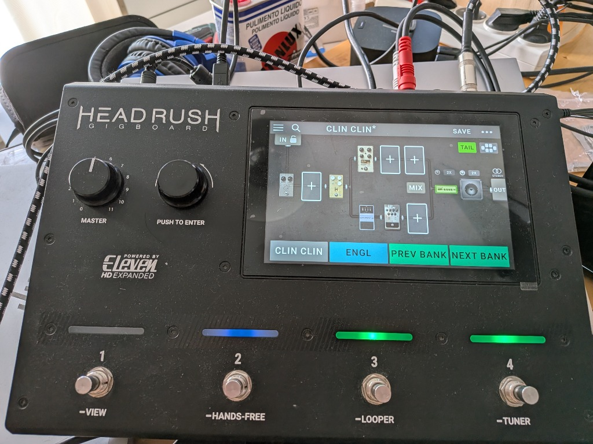
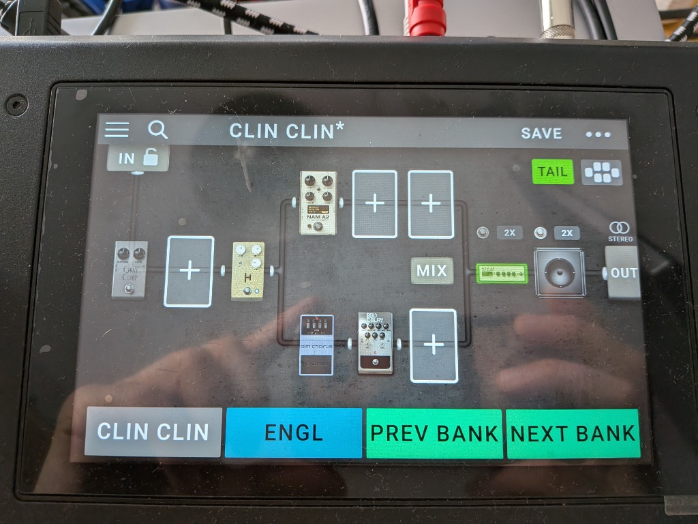
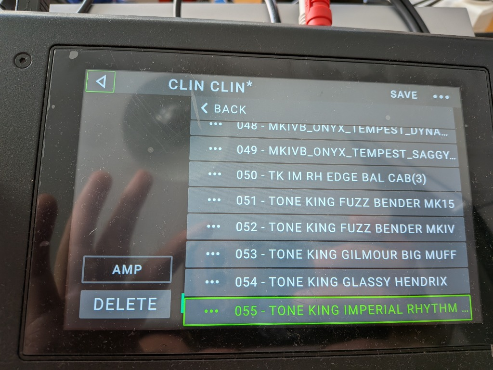
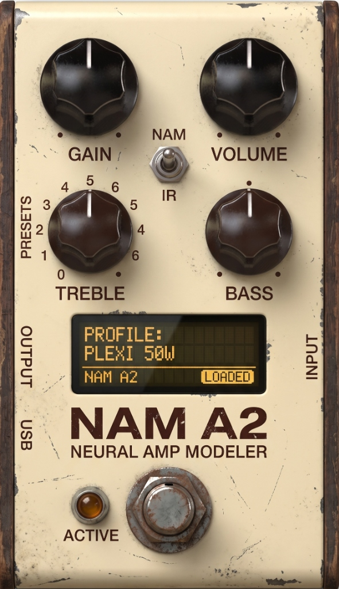
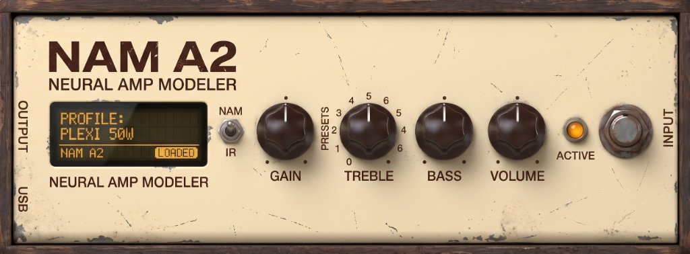

# HeadRush Gigboard — Neural Amp Modeler (NAM) Mod

[](LICENSE)
[](#)
[](https://github.com/sdatkinson/NeuralAmpModelerCore)
[](https://github.com/iosumurillo/GIGBOARD_NAM_AMP_PNG/releases/tag/v2.7-nam-extended)

Modificación avanzada de firmware para **HeadRush Gigboard** (con compatibilidad para MX5 y Pedalboard) con **Firmware 2.7**, que integra de forma nativa la inferencia de redes neuronales [Neural Amp Modeler (NAM)](https://github.com/sdatkinson/NeuralAmpModelerCore) directamente en el motor de audio en tiempo real (`/usr/Evil/Evil`).

### Descargas Oficiales de Producción (Releases)

Para instalar el mod en tu pedalera sin necesidad de compilar código fuente:

| Archivo | Descripción | Descarga Directa |
| :--- | :--- | :--- |
| **Firmware Updater (NAM + Triple Crown + Dev)** | Flasheador completo para HeadRush Gigboard: Dual NAM + 10 amplis custom DSP (Triple Crown, Lone Star, Dumble, Bonneville, IRENE, JON, 5150) + Dev Mode y CPU overlay | [release/HeadRush gigboard Firmware Updater (NAM + Triple Crown + Dev).exe](release/HeadRush%20gigboard%20Firmware%20Updater%20(NAM%20+%20Triple%20Crown%20+%20Dev).exe) |
| **Firmware Updater (NAM A2 extended mod)** | Misma compilación actualizada disponible con el nombre clásico | [release/HeadRush gigboard Firmware Updater (NAM A2 extended mod).exe](release/HeadRush%20gigboard%20Firmware%20Updater%20(NAM%20A2%20extended%20mod).exe) |
| **HeadRush NAM Block Manager** | Gestor de perfiles `.nam`, ordenación USB y generador de `.block` para Windows 10/11 | [release/HeadRush_NAM_Block_Manager.exe](release/HeadRush_NAM_Block_Manager.exe) |

> **Código fuente completo**: [iosumurillo/Gigboard_NAM_Source](https://github.com/iosumurillo/Gigboard_NAM_Source)  
> **Página de la Release anterior**: [v2.7 Extended Edition](https://github.com/iosumurillo/GIGBOARD_NAM_AMP_PNG/releases/tag/v2.7-nam-extended)  
> **Guía técnica y manual de usuario detallado**: [GUIA_NAM_HEADRUSH.md](GUIA_NAM_HEADRUSH.md)

---

## Demostración en Hardware Real (HeadRush Gigboard)

<p align="center">
  
</p>

<p align="center">
  
  
</p>

### Gráficos Integrados en el Motor QML/RCC de HeadRush

| Bloque Pedal: Anxiety OD (NAM) | Bloque Amplificador: 82 LEAD 800 (NAM) |
| :---: | :---: |
|  |  |
| *Diseño vertical para pedal de sobremarcha en la cadena* | *Cabezal apaisado con control de EQ activo de 3 bandas y Presence* |

---

## Características Principales

- **Doble Bloque NAM en Cadena**:
  - **Pedal Anxiety OD (NAM)** (y Anxiety OD V2): Inferencia transparente como pedal de saturación/overdrive con controles de Input Trim, Level y selector de modelo.
  - **Amplificador 82 LEAD 800 (NAM)**: Cabezal completo con inferencia NAM y **Tone Stack Activo** de 3 bandas (Bass a 100 Hz, Mid a 750 Hz, Treble a 3.5 kHz, Presence a 6 kHz) y filtro **Tight Cut HPF** a 150 Hz conmutable.
- **Inferencia de Ultra Baja Latencia**:
  - Motor compilado con soporte vectorial ARM Cortex-A9 NEON (`-mfpu=neon-vfpv4 -mfloat-abi=hard`).
  - Hilo de audio en tiempo real protegido contra caídas de buffer (*underruns*).
- **Transición Suave Duck & Switch**:
  - Rampa matemática de coseno elevado (*raised-cosine*) de 100 ms al cambiar de perfil, eliminando ruidos, clicks o zumbidos digitales.
- **Precarga en Segundo Plano**:
  - El análisis y lectura de perfiles `.nam` desde la unidad USB se realiza en un hilo de baja prioridad para no bloquear la interfaz gráfica ni el audio.
- **Gráficos Integrados en Pantalla Táctil**:
  - Gráficos integrados en los recursos QML/RCC de HeadRush: pedal vertical para Anxiety OD y cabezal horizontal apaisado para 82 LEAD 800.
- **10 Amplificadores Custom Circuit-Modeled (Expansión a 63 Amps, DSP IDs 53–62)**:
  - Lista ampliada sin sustituir ninguno de los 53 amplificadores originales de fábrica:
    - **53 (`0x35`)**: Mesa Triple Crown Ch2 (`MesaTripleCrownDSP`, sobremuestreo 2x a 96 kHz)
    - **54 (`0x36`)**: Mesa Lone Star (`MesaLoneStarDSP`)
    - **55 (`0x37`)**: Mesa Triple Crown Lead (`MesaTripleCrownDSP` canal 3)
    - **56 (`0x38`)**: Dumble Steel String Singer (`DumbleSSSDSP`)
    - **57 (`0x39`)**: Dumble Overdrive Special (`DumbleODSDSP`)
    - **58 (`0x3a`)**: Elmwood Bonneville 50 (`ElmwoodBonnevilleDSP`)
    - **59 (`0x3b`)**: IRENE (Clean Reference Engine híbrido Dumble SSS + Mesa Lone Star)
    - **60 (`0x3c`)**: JON (Modern Progressive Overdrive Engine de 3 voces)
    - **61 (`0x3d`)**: 5150 Original 1992 Rhythm (`Peavey5150DSP`)
    - **62 (`0x3e`)**: 5150 Original LEAD (`Peavey5150DSP`)
  - Gráficos personalizados integrados en pantalla y bloques preconfigurados `MESA TC-100 CH1 CLEAN.block`, `CH2 LO-GAIN.block` y `CH3 HI-GAIN.block` en `presets/Blocks_Para_Tu_Gigboard/AMP/` (también generados automáticamente en el primer arranque).
  - Documentación completa por modelo en [GUIA_NAM_HEADRUSH.md — Fichas Técnicas Individuales](GUIA_NAM_HEADRUSH.md#fichas-técnicas-individuales).

<details>
<summary><strong>Fichas Técnicas Individuales de los 10 Amplificadores Custom (IDs 53–62)</strong></summary>

#### ID 53 — Mesa Triple Crown Ch2 (`MesaTripleCrownDSP`, `channel = 2`)
- **Descripción:** Canal 2 (Lo-Gain) del cabezal Mesa/Boogie TC-100. Voz británica EL34 con mordedura media-alta enfocada, crunch dinámico y pegada orgánica en graves.
- **Cadena DSP:** `in_hpf` (72 Hz OFF / 110 Hz Bright ON) → `tight_peak` (2000 Hz, `Q = 0.95`, +1.5 / +3.2 dB) → Triodo V1 (`asym = 0.10`, `g1 = (0.75 + 6.80 * gain) * (1.25 si Bright)`) → `inter1_hpf` (75 / 105 Hz) → Triodo V2 (`asym = 0.16`, `g2 = 1.15 + 2.70 * gain`) → `inter2_hpf` (78 Hz) → `asym_tanh` (`asym = 0.08`) → Etapa EL34 Push-Pull (`sag = 0.36`, `pre_comp = 0.24`) → Post (`sub_tight_hpf` 48 Hz, `depth_thump` 96 Hz +1.5 dB, `kerrang_peak` 1650 Hz +1.8 dB, `def_peak` 2900 Hz +1.4 dB) → Limitador (`2.0:1 @ 0.50`) → `GuitarToneStack4`.
- **Tone Stack:** Bass 122 Hz (±12 dB) · Mid 720 Hz (`Q = 0.72`, +0.8 dB bias, ±12 dB) · Treble 1650 Hz (±12 dB) · Presence 4150 Hz (±11 dB).
- **Telemetría (50%):** Ganancia 1 kHz +16.62 dB · RMS Nominal 0.2312 · THD 22.32% (80% Gain: 28.05%) · H2: -19.80 dBc · H3: -14.89 dBc · RMS 12 kHz 0.1631.

#### ID 54 — Mesa Lone Star (`MesaLoneStarDSP`)
- **Descripción:** Canal 1 Clean del Mesa/Boogie Lone Star (100W/50W 6L6GC). Combina gran headroom texano, brillo tridimensional en púa y un selector de rectificador en el switch Bright (`0x9518`): Silicon (OFF) para respuesta rápida y firme, o 5U4GB Tube Sag (ON) para compresión elástica de fuente valvular.
- **Cadena DSP:** `in_hpf` (50 Hz) → Triodo V1A (`g = 0.78 + 2.45 * gain`) con inyector cuadrático `2f0` DC-blocked (`-0.12 * (d1_sq - dc_est)`) alineado constructivamente con `asym_tanh` → `ts_mid_body` (380 Hz +2.0 dB) → `sparkle_bell` (2.8 kHz +2.4 dB) → Triodo V1B con auto-compresión (`1 / (1 + 0.12 * env)`, `top35` empuja en el último 35% del Gain) → Power 6L6GC Class AB (`sag = 0.10` Silicon / `0.36` 5U4GB) → `sub_tight_hpf` (52 Hz) → `depth_thump` (84 Hz +1.6 dB) → `air_shelf` (5.8 kHz +1.8 dB) → `GuitarToneStack4`.
- **Tone Stack:** Bass 115 Hz (±12 dB) · Mid 520 Hz (`Q = 0.72`, ±11 dB) · Treble 1650 Hz (±12 dB) · Presence 4200 Hz (±10 dB).
- **Telemetría (50%):** Ganancia 1 kHz +7.01 dB · RMS Nominal 0.2279 · THD 4.36% (80% Gain: 9.84%) · H2: -28.09 dBc · H3: -34.68 dBc · Span dinámico 23.9 dB (0.02 → 0.45).

#### ID 55 — Mesa Triple Crown Lead (`MesaTripleCrownDSP`, `channel = 3`)
- **Descripción:** Canal 3 (Hi-Gain Tight Lead) del TC-100. Diseñado para riffs articulados y solos definidos, con un HPF de entrada dinámicamente acoplado al control Bass (bajar Bass aprieta automáticamente el subgrave antes de la saturación).
- **Cadena DSP:** `in_hpf` dinámico (`118 Hz OFF / 142 Hz ON + (0.5 - bass) * 28 Hz`, rango 90..168 Hz) → `tight_peak` (1150 Hz, `Q = 1.20`, +2.0 / +3.2 dB) → Triodo V1 (`g1 = (1.10 + 11.5 * gain) * bright_mul`, `asym = 0.12`) → `inter1_hpf` (95 / 125 Hz) → `asym_tanh` (`1.65 + 1.85 * gain`, `asym = 0.14`) → `inter2_hpf` (95 Hz) → Triodo V2 (`1.50 + 3.30 * gain`, `asym = 0.34`) → `asym_tanh` (`1.75`, `asym = -0.06`) → Power EL34 rígido (`sag = 0.18`, atk 4.5 ms) → `kerrang_peak` (1620 Hz +3.0 dB) → `def_peak` (3000 Hz +1.6 dB) → Limitador (`3.2:1 @ 0.48`) + `tanh(0.9y) / 0.9` → `GuitarToneStack4`.
- **Tone Stack:** Bass 122 Hz (±12 dB) · Mid 560 Hz (`Q = 0.72`, scoop base -2.6 dB, ±12 dB) · Treble 1650 Hz (±12 dB) · Presence 4150 Hz (±11 dB).
- **Telemetría (50%):** Ganancia 1 kHz +20.52 dB · RMS Nominal 0.2531 · THD 26.75% (80% Gain: 28.91%) · H3: -12.82 dBc · RMS 12 kHz 0.2748.

#### ID 56 — Dumble Steel String (`DumbleSSSDSP`)
- **Descripción:** Inspirado en el Steel String Singer #002 (100W–150W 6L6GC/6550). Arquitectura ultra-limpia con extensión profunda de graves (35 Hz HPF), scoop de medios en 400 Hz y timbre cristalino tipo piano para absorber pedales delante o tocar limpios con enorme dinámica.
- **Cadena DSP:** `in_hpf` (35 Hz) → Previo lineal simétrico `tanh(pre_gain * sig * 0.5) / 0.5` (`0.50 + 1.85 * gain`) → `mid_scoop` (400 Hz, -4.2 dB) → `chime_peak` (2200 Hz, +3.0 dB) → `bright_shelf` (3800 Hz, +3.5 dB si Bright ON) → Power Stage rígido (`sag = 0.05`, rel 58 ms) + compresión de inversor de fase (`pi_comp = 0.16`) → `depth_thump` (90 Hz +1.6 dB) → `air_peak` (4800 Hz +1.5 dB) → `GuitarToneStack4`.
- **Tone Stack:** Bass 122 Hz (±12 dB) · Mid 500 Hz (`Q = 0.72`, ±11 dB) · Treble 1700 Hz (±12 dB) · Presence 4200 Hz (±10 dB).
- **Telemetría (50%):** Ganancia 1 kHz +7.70 dB · RMS Nominal 0.2212 · THD 0.27% (80% Gain: 0.51%, el más lineal) · Span dinámico 26.4 dB (0.02 → 0.45) · RMS @ 0.70 = 0.6538.

#### ID 57 — Dumble ODS (`DumbleODSDSP`)
- **Descripción:** Dumble Overdrive Special (#102/#124, canal Overdrive) con voicing Skyliner. Con Bright=OFF entrega un overdrive cremoso y vocal; al activar Bright=ON entra en acción la entrada FET real (+12.5 dB / 4.2x) con mordedura JFET en 2.2 kHz que empuja la cascada OD1/OD2 a saturación densa y bloom armónico.
- **Cadena DSP:** `in_hpf` (65 Hz) → `[Opcional Bright=ON: ganancia 4.2x + 2f0 JFET + tanh(0.16s + 0.03)]` → Etapa Clean (`0.75 + 1.55 * gain`, `asym = 0.08`) → `skyliner_mid` (580 Hz +2.0 dB) → `bright_shelf` (2.2 kHz +3.8 dB ON) → `inter_hpf` (75 Hz) → Triodo OD1 (`0.75 + 4.50 * gain`, `asym = 0.22`, bloom 30/210 ms) → `gnarly_growl` (1550 Hz +1.8 dB) → Inyección `0.09 * tanh(4.2 * sig)` → Triodo OD2 (`0.80 + 2.90 * gain`, `asym = 0.28`) → Power Stage (`sag = 0.24`, `pre_comp = 0.22`, `bias = 0.075`) → `sub_tight_hpf` (50 Hz) → `depth_thump` (102 Hz +1.4 dB) → `def_peak` (4800 Hz +1.8 dB) → `GuitarToneStack4`.
- **Tone Stack:** Bass 122 Hz (±12 dB) · Mid 620 Hz (`Q = 0.72`, ±11 dB) · Treble 1680 Hz (±12 dB) · Presence 4150 Hz (±10 dB).
- **Telemetría (50%):** Ganancia 1 kHz +14.13 dB (+5.65 dB con FET ON) · RMS Nominal 0.2294 · THD 25.66% (80% Gain: 34.25%) · H2: -19.44 dBc · H3: -13.47 dBc.

#### ID 58 — Elmwood Bonneville 50 (`ElmwoodBonnevilleDSP`)
- **Descripción:** Amplificador boutique sueco de 50W EL34 (híbrido Plexi-AC30 crudo). Destaca por incorporar el motor `ProgramSustain` con hasta +20 dB de recuperación controlada por puerta anti-ruido (-63 a -52 dBFS) y una cascada de 5 triodos con asimetrías alternadas para un grano británico orgánico y canto infinito en solos.
- **Cadena DSP:** `ProgramSustain` (atk 10 ms, rel 150 ms, `max_up 10.5x`, `min_down 0.30x`) → `pre_hpf` (75/95 Hz) → `pre_clarity` (2.2 kHz +2.0 dB) → `bright_chime` (2.6 kHz +3.2 dB ON) → 4 Triodos en cascada (V1 +0.18 → `inter_hpf` 75 Hz → V2 -0.14 → V3 +0.15 → V4 -0.10) → Cathode Follower (+0.06) → Power 50W EL34 (`sag = 0.16`, `bias = 0.035`) → `post_wood_body` (880 Hz +1.8 dB) → `post_kerrang` (2150 Hz +1.8 dB) → `GuitarToneStack4`.
- **Tone Stack:** Bass 85 Hz (±12 dB) · Mid 820 Hz (`Q = 0.72`, ±11 dB) · Treble 1680 Hz (±12 dB) · Presence 3650 Hz (±10 dB).
- **Telemetría (50%):** Ganancia 1 kHz +20.83 dB · RMS Nominal 0.2334 · THD 43.21% (80% Gain: 45.78%) · RMS sostenido `0.2186..0.2324` en todo el rango `0.01..0.70` · RMS 12 kHz 0.2057.

#### ID 59 — IRENE (`IreneCleanDSP`)
- **Descripción:** Clean Reference Engine — diseño original híbrido que fusiona la velocidad y headroom del Dumble SSS con la calidez 3D del Lone Star. Usa un compresor óptico paralelo (`tick_optical`, 55% mezcla paralela) con ataque lento de 35 ms para dejar pasar intacto el ataque de la púa, ecualización de mezcla lista para grabación y un generador puro de 2º armónico par (`2f0`) tipo triodo de 400V con aire abierto hasta 18 kHz.
- **Cadena DSP:** `pre_hpf` (68 Hz) → `ProgramSustain::tick_optical` (atk 35 ms, rel 220 ms, 1.75:1, +5/-4.5 dB, mix 55%) → Esculpido de estudio (105 Hz low-shelf +1.0 dB → 320 Hz dip -2.0 dB → 1050 Hz vocal +2.0 dB → 2.8 kHz chime +3.2 dB → 5.2 kHz air-shelf +2.6 / +5.4 dB Bright ON) → Generador 400V `2f0` (`k2 = 0.11 + 0.12 * gain`, DC-blocked) + `tanh(0.18s) / 0.18` → Power 100W 6L6GC/KT66 (`sag = 0.12`, `bias = 0.015`) → `GuitarToneStack4`.
- **Tone Stack:** Bass 118 Hz (±12 dB) · Mid 820 Hz (`Q = 0.72`, ±11 dB) · Treble 1800 Hz (±12 dB) · Presence 4400 Hz (±10 dB).
- **Telemetría (50%):** Ganancia 1 kHz +11.97 dB · RMS Nominal 0.2202 · THD 2.20% (80% Gain: 3.78%) · H2: -33.20 dBc vs H3: -53.98 dBc (+20.8 dB halo par) · Span dinámico 21.8 dB (0.02 → 0.45) con pico de ataque 0.860.

#### ID 60 — JON (`JonOverdriveDSP`)
- **Descripción:** Modern Progressive Overdrive Engine — arquitectura original de 3 voces progresivas controladas por el propio recorrido de Gain: desde Clean/Blues cálido en valores bajos, pasando por Liquid Lead en rango medio, hasta Surgical Tight Metal al subir Gain por encima del 36%, donde realiza un crossfade continuo (`blend_45`) hacia una doble etapa de recorte de grano fino inspirada en Soldano/Triple Crown.
- **Cadena DSP:** `pre_hpf` adaptativo (68 → 137 Hz + trim inverso con Bass) → `pre_dip` adaptativo en 320 Hz (0 → -3.8 dB) → `pre_focus` deslizante (520 Hz +1.2 dB → 1400 Hz +2.4 dB) → `bright_boost` (2.3 kHz +3.2 dB ON) → S1 lineal → S2/S3 triodos bloom (30/190 ms) → `inter_hpf` (115 Hz) → Crossfade `blend_45` hacia `[S4 (2/65 ms, asym = 0.05) → S5 (tanh 0.90) → CF (asym = 0.04)]` → Power Stage (`sag = 0.12`, `bias = 0.02`) → `nfb_punch` (78 Hz +1.0 dB) → `post_clean_dip` (340 Hz -2.2 dB) → `post_soldano_edge` (1450 Hz +2.2 dB) → `GuitarToneStack4 (* blend_trim)`.
- **Tone Stack:** Bass 122 Hz (±12 dB) · Mid 640 Hz (`Q = 0.72`, ±12 dB) · Treble 1700 Hz (±12 dB) · Presence 4200 Hz (±10 dB).
- **Telemetría (50%):** Ganancia 1 kHz +17.71 dB · RMS Nominal 0.2366 · THD 17.02% (80% Gain: 25.90%) · H2: -24.32 dBc · H3: -16.36 dBc · RMS 12 kHz 0.1859.

#### ID 61 — 5150 Original 1992 Rhythm (`Pv5150DSP`, `is_lead = false`)
- **Descripción:** Canal Rhythm del Peavey 5150 "Block Letter" de 1992 (topología V1A → V1B → V6A + etapa 4x6L6GC). Usa el layout nativo `0x29` con controles Pre Gain, Resonance, Post, High/Mid/Low, Presence y switch Bright (que emula el condensador treble-bleed de 4700 pF sobre el potenciómetro Pre Gain, atenuándose al subir la ganancia).
- **Cadena DSP:** `pre_hpf` (56..80 Hz) → `pre_mid_push` (820 Hz +1.0 dB) → `bright_shelf` (`2.35 kHz`, `+4.4 dB * (1 - 0.65 * pre_gain)` ON) → Triodo V1A (`asym = 0.06`) → `inter_hpf` (72 Hz) → V1B (`asym = 0.14`) → V6A (`asym = 0.18`) → `inter_fizz` (-1.2 dB @ 5.4 kHz) → Power 4x6L6GC (`sag = 0.11`, `bias = 0.045`, Post > 70% añade saturación de potencia) → `nfb_resonance` (72 Hz, `Q = 1.05`, 0 → +8.6 dB, +4.3 dB al 50%) → `GuitarToneStack4`.
- **Tone Stack:** Low 116 Hz (±12 dB) · Mid 680 Hz (`Q = 0.72`, ±12 dB) · High 1860 Hz (±12 dB) · Presence 3950 Hz (±10 dB).
- **Telemetría (50%):** Ganancia 1 kHz +9.19 dB · RMS Nominal 0.2429 · Resonance @ 72 Hz: +4.30 dB (50%) / +8.60 dB (100%) · Bright @ 3.5 kHz: +2.81 dB · THD 17.04% (80% Gain: 28.24%).

#### ID 62 — 5150 Original LEAD (`Pv5150DSP`, `is_lead = true`)
- **Descripción:** Canal LEAD del Peavey 5150 "Block Letter" 1992 (layout `0x2b`). Cascada completa de 5 etapas incluyendo la icónica etapa V2B con cátodo frío de 39k (`asym = 0.42f`), que genera su saturación agresiva y densidad armónica característica sin muro pasa-bajos (conservando apertura hasta ~15 kHz). El switch Bright no tiene efecto en el canal LEAD, tal como en el amplificador original.
- **Cadena DSP:** `pre_hpf` (82..114 Hz) → `pre_mid_push` (1050 Hz +2.4 dB) → V1A (`asym = 0.08`) → `inter_hpf` (112 Hz) → V2A (`asym = 0.12`) → V2B 39k Cold Clipper (`asym = 0.42`) → `inter_fizz` (-3.2 dB @ 5.4 kHz) → V6A (`asym = 0.16`) → `tanh(0.92s) / 0.92` → Power 4x6L6GC (`sag = 0.11`, `bias = 0.045`) → `nfb_resonance` (72 Hz, `Q = 1.12`, 0 → +9.4 dB, +4.7 dB al 50%) → `GuitarToneStack4`.
- **Tone Stack:** Low 112 Hz (±12 dB) · Mid 650 Hz (`Q = 0.76`, ±12 dB) · High 1820 Hz (±12 dB) · Presence 4150 Hz (±10 dB).
- **Telemetría (50%):** Ganancia 1 kHz +18.84 dB · RMS Nominal 0.2490 · Resonance @ 72 Hz: +4.69 dB (50%) / +9.39 dB (100%) · Presence @ 4.2 kHz (0% → 100%): +9.80 dB · THD 35.45% (80% Gain: 36.37%) · RMS 10 kHz 0.1793.

</details>
- **Modo Ingeniería (Dev Mode) y Medidor de CPU DSP**:
  - `EnableDevAccess` activado por defecto y `GlobalSettings.qml` parcheado para desbloquear las 3 pantallas ocultas (`dev menu`, `ampTweak`, `fftDisplay`) con controles táctiles.
  - Overlay de CPU del DSP (`ShowCPUTime` / `EngineInfo.qml`) visible desde el arranque.
- **HeadRush NAM Block Manager GUI**:
  - Herramienta de escritorio moderna incluida en `release/` para detectar pendrives USB, ordenar modelos alfabéticamente, calibrar trims y generar automáticamente bloques `.block` de presets listos para usar.
- **100+ Bloques Presets Incluidos**:
  - En la carpeta `presets/Blocks_Para_Tu_Gigboard` encontrarás bloques ya generados para carga instantánea (`ANXIETY OD`, `ANXIETY OD V2` y `AMP`).

---

## Estructura del Repositorio

```text
Gigboard_NAM/
├── docs/                 # Documentación e imágenes
│   ├── images/           # Fotografías en hardware real y recursos gráficos
│   └── RECOVERY.md       # Procedimiento de recuperación a firmware oficial
├── presets/              # Bloques listos para transferir a la memoria de la pedalera
│   └── Blocks_Para_Tu_Gigboard/
│       ├── AMP/              # Presets MESA TC-100 (CH1 CLEAN, CH2 LO-GAIN, CH3 HI-GAIN)
│       ├── ANXIETY OD/       # Presets 000 a 100 para pedal
│       └── ANXIETY OD V2/    # Presets 000 a 100 para segunda instancia
├── release/              # Ejecutables listos para producción
│   ├── HeadRush gigboard Firmware Updater (NAM + Triple Crown + Dev).exe
│   ├── HeadRush gigboard Firmware Updater (NAM A2 extended mod).exe
│   └── HeadRush_NAM_Block_Manager.exe
├── GUIA_NAM_HEADRUSH.md  # Manual técnico y guía completa de usuario
├── LICENSE               # Licencia GPLv3
└── README.md             # Esta documentación
```

---

## Mapeo de Controles

### Bloque Pedal: Anxiety OD (NAM)

| Control | Rango | Función Técnica |
| :--- | :--- | :--- |
| **Tone** | 0% – 100% | **Input Trim**: 50% = Ganancia Unitaria (0.0 dB). 0% = Mute, 100% = +12 dB. |
| **Drive** | 0% – 100% | **Selector de Modelo NAM**: Selecciona el archivo `.nam` correspondiente del pendrive USB (`0%` = Archivo 0, `100%` = Archivo 100). |
| **Level** | 0% – 100% | **Output Trim**: 50% = Salida Unitaria (0.0 dB). 0% = Mute, 100% = +12 dB. |
| **On/Off**| Bypass | Paso en seco directo (*dry passthrough*). |

---

### Bloque Amplificador: 82 LEAD 800 (NAM)

| Página | Control | Rango | Función Técnica |
| :--- | :--- | :--- | :--- |
| **Pág 1** | **Gain** | 0% – 100% | Ganancia de entrada previa a la red neuronal (50% = 0 dB). |
| **Pág 1** | **Presence** | 0% – 100% | Filtro High-Shelf activo en 6 kHz ($\pm 10\text{ dB}$, 50% = plano). |
| **Pág 1** | **Master** | 0% – 100% | Nivel de salida general post-inferencia y EQ (50% = 0 dB). |
| **Pág 2** | **Bass** | 0% – 100% | Filtro Low-Shelf centrado en 100 Hz ($\pm 12\text{ dB}$, 50% = plano). |
| **Pág 2** | **Mid** | 0% – 100% | Filtro Peaking en 750 Hz, $Q=1.0$ ($\pm 12\text{ dB}$, 50% = plano). |
| **Pág 2** | **Treble** | 0% – 100% | Filtro High-Shelf en 3.5 kHz ($\pm 12\text{ dB}$, 50% = plano). |
| **Pág 3** | **Depth** | 0% – 100% | **Selector de Modelo NAM**: Mapeo 1:1 exacto alfabético de perfiles USB. |
| **Pág 3** | **Bright** | OFF / ON | **Filtro Tight HPF (150 Hz)**: Elimina graves fangosos antes de la distorsión. |

---

## Inicio Rápido

### 1. Flashear la Pedalera
1. Conecta tu HeadRush Gigboard a la PC mediante cable USB.
2. En la pedalera, entra en **Global Settings -> Firmware Update**.
3. Ejecuta `HeadRush gigboard Firmware Updater (NAM + Triple Crown + Dev).exe` (o `HeadRush gigboard Firmware Updater (NAM A2 extended mod).exe`) desde la carpeta `release/`.
4. Sigue los pasos en pantalla hasta que la pedalera complete el flasheo y reinicie.

### 2. Cargar Modelos en el Pendrive USB
1. En la pedalera, activa el modo **USB Transfer**.
2. Ejecuta `HeadRush_NAM_Block_Manager.exe` desde la carpeta `release/`.
3. Selecciona los modelos que deseas transferir. La herramienta organizará los nombres con prefijos numéricos ordenados alfabéticamente y generará los bloques de preset en las carpetas `Blocks/ANXIETY OD` y `Blocks/ANXIETY OD V2`.

### 3. Presets Listos para Copiar
Si prefieres no usar el gestor automático, puedes copiar directamente el contenido de la carpeta `presets/Blocks_Para_Tu_Gigboard` dentro de la carpeta `Blocks` del almacenamiento USB de tu HeadRush.

---

## Recuperación y Seguridad

El mod preserva la estructura de actualización oficial de HeadRush. Para restaurar el firmware original de fábrica en cualquier momento:
1. Pon la Gigboard en modo actualización de firmware.
2. Ejecuta el actualizador oficial de HeadRush Firmware 2.7.
3. Para más detalles, consulta [docs/RECOVERY.md](docs/RECOVERY.md).

---

## Licencia

- El código del mod y los hooks de integración están bajo la licencia [GPL v3](LICENSE).
- NeuralAmpModelerCore está bajo la licencia [MIT](https://github.com/sdatkinson/NeuralAmpModelerCore/blob/main/LICENSE).
- Las marcas HeadRush, Gigboard, MX5 y Pedalboard son marcas registradas de inMusic Brands, Inc. Este proyecto es una modificación comunitaria independiente y de código abierto sin afiliación con inMusic Brands.
